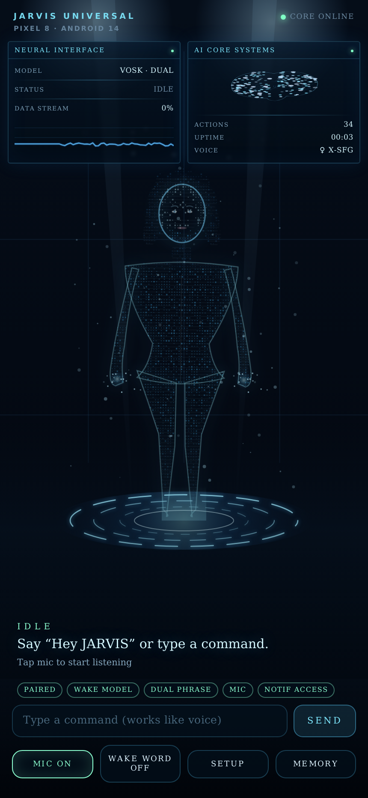

# JARVIS UNIVERSAL — Android device-resident assistant

A real Android integration, not a web app pretending to have OS privileges. Two native halves and
a local bridge:

```
┌──────────────────────────── Android phone ────────────────────────────┐
│                                                                        │
│  ┌───────────────────────────┐        ┌─────────────────────────────┐  │
│  │ JARVIS UNIVERSAL (Kotlin) │        │ Termux intelligence core    │  │
│  │                           │        │ (Python, 127.0.0.1:8765)    │  │
│  │ • WakeWordService         │◄──────►│ • AI orchestration          │  │
│  │   microphone foreground   │ HTTP + │ • intent + planning         │  │
│  │   service, stays alive    │  WS    │ • memory (SQLite, AES)      │  │
│  │ • offline Vosk wake word  │        │ • tool validation           │  │
│  │ • command capture         │        │ • audit + rate limiting     │  │
│  │ • DeviceControlService    │        │ • local Vosk transcription  │  │
│  │   34 registered actions   │        │   (optional)                │  │
│  │ • female TTS + lip sync   │        └─────────────────────────────┘  │
│  │ • holographic WebView UI  │                                         │
│  └───────────────────────────┘                                         │
└────────────────────────────────────────────────────────────────────────┘
```

- **Wake phrases:** “Hey JARVIS” and “JARVIS”, detected **offline** (Vosk, grammar-constrained).
- **Always available:** works with the holographic interface closed, via an Android microphone
  foreground service and its mandatory notification.
- **Voice:** command capture → transcription → plan → **authorization** → execution → verification
  → spoken reply in a female voice.
- **Camera vision:** front and rear cameras, on-device face/object/text/barcode detection, opt-in
  remote reasoning. Runs only from a visible camera foreground service, with a notification, a HUD
  badge and an immediate stop.
- **No shell:** the AI can only invoke registered, argument-validated, permission-checked actions.

### The interface

A volumetric particle figure standing on a glowing pedestal, with live telemetry either side:
`NEURAL INTERFACE` (wake model, phase, microphone waveform) and `AI CORE SYSTEMS`
(registered action count, session uptime, selected voice). Every value is real — it comes from
`JarvisNative.status()`, not a mock.

| Idle | Listening | Speaking |
|---|---|---|
|  |  |  |

Rendered from `android/app/src/main/assets/hologram/index.html` — the app's actual WebView asset —
with state injected through the same `window.jarvis.*` bridge the Kotlin layer uses.

### Camera vision

JARVIS sees through the same assistant, not a second app. Say **“activate the rear camera”**,
**“what am I looking at”**, **“read this”**, **“identify this”**, **“switch camera”** or
**“stop camera”** — or use the plan the core produces for those phrases.

```
CameraX frame ──▶ ML Kit (on device) ──▶ SceneSnapshot ──▶ evidence ──▶ answer
                    face / object           presence,       (no image)     │
                    text / barcode          facing, position,              ▼
                                            labels, OCR          core /vision/analyze
                                                                       (frame only if you
                                                                        opted in) ──▶ speech
```

| Capability | How it works |
|---|---|
| Face detection, presence, position, head orientation, attention | ML Kit face detector (on device); yaw/pitch decide “facing the camera” |
| User identity | **Not implemented** — the camera never claims to know who someone is |
| Object detection / classification | ML Kit object detector (on device), labels + confidence |
| OCR, documents, barcodes/QR | ML Kit text recognition and barcode scanning |
| Scene understanding | Coarse hint from detected labels; reported as a hint, not a classifier |
| Visual question answering | Your configured model, but only if it accepts images; otherwise the answer is built from on-device evidence |
| Visual change detection | Label-set Jaccard distance between snapshots |

Privacy in one line: **frames are analysed on the phone, nothing is recorded, and remote reasoning
is off until you enable it in setup (step 21)**. When it is on, one still frame per question goes to
the provider you already configured — never a continuous feed.

Status summary (details in [docs/FEATURE_MATRIX.md](docs/FEATURE_MATRIX.md) and
[docs/ACCEPTANCE_TESTS.md](docs/ACCEPTANCE_TESTS.md)):

| Area | State |
|---|---|
| Android app compiles, debug + release APKs build | verified in this workspace |
| Wake-phrase matching, argument validation, camera scene logic (JVM unit tests) | 40 tests passing |
| Termux core (pytest, includes the vision adapter) | 56 tests passing |
| Core ↔ HTTP bridge (pairing, plan, execute, auth, refusals) | integration tested over real HTTP |
| Scripts (install / update / diagnostics / uninstall) | executed here against a real install |
| On-device wake detection, calls, TTS, service survival | **implemented, not device-tested** — no phone in this environment |
| Camera capture, ML Kit detection, camera voice commands | **implemented, not device-tested** — needs a phone with cameras |

## Layout

| Path | What it is |
|---|---|
| `android/` | Kotlin app (Gradle, minSdk 26, targetSdk 34) |
| `core/` | Python intelligence core (FastAPI + SQLite) |
| `scripts/` | Termux install / update / pair / boot / diagnostics / uninstall |
| `docs/` | architecture, bridge API, security, compatibility, matrix, acceptance tests, setup, build |
| `artifacts/` | built debug APK |

## Quick start

**1. Core on the phone (Termux, F-Droid build)**

```bash
pkg update && pkg install python git
git clone <this-repo> ~/jarvis-universal
cd ~/jarvis-universal && ./scripts/termux-install.sh
# optional: export a provider key in ~/.jarvis/env (see docs/SETUP.md)
~/jarvis-core/start.sh
```

**2. App**

```bash
cd android && ./gradlew assembleDebug
adb install -r app/build/outputs/apk/debug/app-debug.apk
```

Or install `artifacts/jarvis-universal-debug.apk`.

**3. Pair and enable**

Open the app → **Setup** → grant microphone and notifications → install the offline wake model
(step 4) → pair with the code from `./pair.sh` (step 8) → grant “Display over other apps” if you
want JARVIS to open apps while its UI is closed → run the wake-word test (step 17).

Full walkthrough: [docs/SETUP.md](docs/SETUP.md).

## Build and test

```bash
# Android: unit tests + APK
cd android && ./gradlew testDebugUnitTest assembleDebug

# Core: tests
cd core && python3 -m venv .venv && .venv/bin/pip install -r requirements-dev.txt
.venv/bin/python -m pytest -q
```

Requires JDK 17 and Android SDK 34 for the app; Python 3.10+ for the core.

## What it cannot do (by design or by Android)

- No arbitrary shell, root, ADB, or package installation.
- No covert camera use. The camera runs only while its foreground service is active (notification
  visible), only after you grant the permission, and never while the device is locked — Android
  forbids it and JARVIS says so instead of pretending.
- No facial identity recognition. JARVIS reports that a person is present and roughly where they
  are; it does not claim to know who they are.
- No video recording. Nothing from the camera is written to storage.
- No interception of ordinary cellular call audio; calls report exactly what Telecom accepts.
- No silent SMS, no silent payments, no disabling of device security.
- “Open an app while JARVIS' UI is closed” needs the display-over-other-apps grant, because
  Android 10+ blocks background activity starts. Without it the action refuses and says why.
- Per-SIM call routing is only used when Android lets a SIM be mapped to a Telecom account.

Every refused or failed operation is reported as such; the assistant never claims an action
succeeded unless the device returned success.

## Licence / third-party components

Vosk (Apache-2.0) is bundled for offline recognition. Picovoice Porcupine is **optional** and not
bundled; using it needs a Picovoice account and, for “Hey JARVIS”, a custom keyword file.
